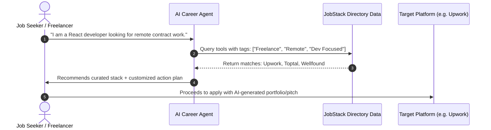

# JobStack — Project Scenarios, System Requirements & AI Productivity Guide

---

## 1. Executive Summary & Vision

**JobStack** (`jobstack`) is a modern, high-performance web directory and platform catalog designed for freelancers, remote engineers, digital creators, and job seekers. It aggregates the world's premier job discovery engines, freelance marketplaces, cold outreach tools, portfolio platforms, and AI-powered job application utilities into a single, unified interface.

### Core Value Proposition

- **High-Signal Curation**: Handpicked, vetted platforms eliminating spam and low-quality job boards.
- **Sub-Millisecond Speed**: Instantaneous client-side search, filtering, and navigation powered by constant-time ($O(1)$) operations.
- **Distraction-Free UX**: Clean desktop & mobile interfaces with zero layout shifts, zero-gap sticky toolbars, and rich keyboard navigation.
- **Deep Tool Inspection**: One-by-one sequential modal explorer (`←` / `→` arrow keys) showcasing key features, pricing models, community ratings, and direct platform access.
- **Adaptive Visual System**: First-class dark and light theme system with zero-flicker DOM initialization and SVG brand icons.

---

## 2. Target Personas

| Persona                                        | Role & Context                                                           | Primary Need in JobStack                                                                                  |
| :--------------------------------------------- | :----------------------------------------------------------------------- | :-------------------------------------------------------------------------------------------------------- |
| **Alex — Freelance Software Engineer**         | Senior full-stack developer seeking premium international contracts.     | Direct access to vetted, high-paying platforms (Toptal, Upwork, Contra) with verified payment protection. |
| **Priya — Remote Tech Job Hunter**             | Software engineer actively seeking full-time remote or hybrid positions. | Premier aggregators and job boards (LinkedIn, Indeed, Naukri, Wellfound, Remote OK) without noisy ads.    |
| **Marcus — Growth & Cold Outreach Specialist** | Freelancer or agency founder prospecting decision-makers.                | Cold email databases, verified lead finders (Hunter, Apollo, Lemlist) to automate outreach.               |
| **Sofia — AI-Accelerated Job Seeker**          | Modern candidate using automation to accelerate job applications.        | AI resume parsers, auto-fillers, and cover letter generators (LazyApply, Teal, Resume Worded).            |
| **Elena — Creative Designer / Writer**         | UI/UX designer and content strategist building a brand.                  | Dedicated portfolio showcases (Behance, Dribbble, ReadCV) and creative networks.                          |
| **Curator / Tool Creator**                     | Developer or product founder submitting a new career platform.           | Seamless submission channel (`hello@jobstack.dev`) with standardized metadata specs.                      |

---

## 3. End-to-End User Scenarios

```mermaid
flowchart TD
    A[Visitor Enters JobStack] --> B{Choose Entry Point}
    B -->|Home Page| C[View Hero Stats & Community Highlights]
    B -->|Categories Preview| D[Click Category Card]
    B -->|Navbar Link| E[Open All Tools Directory]

    C --> F[Browse 6 Featured Cards]
    F --> G[Click Tool Card / Explore Button]

    D --> H[Navigate to #/tools?cat=CategoryName]
    E --> I[Navigate to #/tools with All Categories]

    H --> J[Filtered Directory View with Category Header]
    I --> K{Choose View Mode}
    K -->|Sections Mode| L[Grouped Category Blocks]
    K -->|Grid Mode| M[Unified Responsive Grid]

    J & L & M --> N[Live Search Query Input]
    N --> O[Real-Time O(1) Filtered Results]

    O --> P[Click Card / Explore]
    P --> Q[Open Interactive Tool Detail Modal]

    Q --> R{Modal Interaction}
    R -->|Keyboard ← / →| S[Previous / Next Tool]
    R -->|Click Visit| T[Open Official Tool Website]
    R -->|Press ESC or Close| U[Return to Directory View]
```

### Scenario 1: First-Time Discovery & Highlights

- **Trigger**: User visits the landing page (`#/`).
- **Flow**:
  1. User reads the headline, handpicked statistics (total tools, categories), and primary CTA buttons.
  2. Scrolls to "Community Highlights" showcasing top-rated, popular tools.
  3. Inspects ratings, pricing tags, and badges (e.g. `Most Popular`, `Elite`, `Dev Focused`).
  4. Clicks "View All Tools" to transition into the complete directory.

### Scenario 2: Category-Specific Exploration

- **Trigger**: User clicks a category card (e.g. "Freelance Platforms" or "Cold Outreach") on the home page or navbar.
- **Flow**:
  1. The app updates hash routing (`#/tools?cat=Freelance%20Platforms`) and smoothly scrolls to top.
  2. The dedicated `/tools` page renders with the active category tab highlighted.
  3. A standardized category section bar displays:
     - Category icon (`Briefcase`, `Target`, `Zap`, `Send`, `Users`, `Palette`).
     - Category name and exact tool count badge.
     - Descriptive summary explaining the category value.
     - "View All Categories" shortcut button.
  4. Only tools matching that category render in the responsive grid.

### Scenario 3: Real-Time Fuzzy Search & Filter Combination

- **Trigger**: User enters keywords into the sticky toolbar search box.
- **Flow**:
  1. Input event triggers immediate client-side filtering ($O(N)$ single-pass evaluation across name, tagline, description, category, and tags).
  2. If search yields matching items, they render instantly with match counts (`Showing X tools matching "query"`).
  3. If no items match, an empty state renders with an icon, explanatory text, and a one-click "Reset Filters" button.
  4. User can clear input via an inline `X` button or by clearing text.

### Scenario 4: One-by-One Sequential Tool Inspection

- **Trigger**: User clicks any tool card or its "Explore" button.
- **Flow**:
  1. Global modal overlays the screen, locking background scroll (`document.body.style.overflow = "hidden"`).
  2. Displays active tool counter (e.g., `Tool 4 of 18 tools`), brand logo, title, badge, tagline, rating, pricing, full description, and key capabilities checklist.
  3. User navigates sequentially:
     - Pressing **Left Arrow** (`←`) or clicking **Prev** loads the previous tool in the dataset.
     - Pressing **Right Arrow** (`→`) or clicking **Next** loads the next tool in the dataset (with circular loop).
     - Pressing **Escape** (`Esc`) or clicking outside closes the modal and restores scrolling.
  4. Clicking "Visit [Tool Name]" opens the external URL in a secure new tab (`target="_blank"` with `rel="noopener noreferrer"`).

### Scenario 5: Dark and Light Theme Personalization

- **Trigger**: User toggles the theme button in the navigation bar.
- **Flow**:
  1. Theme toggler fires `toggleTheme()` from `ThemeContext`.
  2. Executes an $O(1)$ attribute switch: `document.documentElement.setAttribute("data-theme", "light" | "dark")`.
  3. Updates the `<meta name="theme-color">` tag to match background color.
  4. Persists setting in browser `localStorage.setItem("jobstack_theme", theme)` for zero-flash return visits.
  5. Automatically adapts to OS color scheme changes (`prefers-color-scheme`) if the user has not explicitly overridden.

### Scenario 6: Tool Curation & Community Submission

- **Trigger**: User reaches the submission section on the home page.
- **Flow**:
  1. User clicks "Submit a Tool", opening a pre-addressed email draft to `hello@jobstack.dev`.
  2. Curation criteria are applied before merging new tools into `src/data/tools.json`.

---

## 4. System Requirements

### 4.1 Functional Requirements (FR)

| Req ID    | Requirement Title                | Description & Acceptance Criteria                                                                                                                                                            |
| :-------- | :------------------------------- | :------------------------------------------------------------------------------------------------------------------------------------------------------------------------------------------- |
| **FR-1**  | **Curated Tool Directory**       | System must store and present tools containing: ID, Name, Tagline, Description, URL, Logo/Brand, Category, Tags, Pricing, Rating, Featured flag, Badge, and Features list.                   |
| **FR-2**  | **Dedicated Directory View**     | A separate `/tools` view must be provided to maximize vertical screen space and keep headers streamlined.                                                                                    |
| **FR-3**  | **Hash-Based Routing**           | Support client-side navigation between `#/` (home) and `#/tools` (with optional `?cat=CategoryName`), reacting to browser forward/back buttons.                                              |
| **FR-4**  | **Sticky Toolbar & Zero Gap**    | Navigation bar (64px) and toolbar directly beneath it must maintain zero vertical gap during scrolling, with backdrop blur and high z-index.                                                 |
| **FR-5**  | **Category Filtering**           | Ability to filter tools by category. Empty categories with 0 tools must be automatically excluded from active tabs.                                                                          |
| **FR-6**  | **Dual View Modes in "All"**     | When viewing all tools without an active search query, allow toggling between: <br>1. **Sections Mode**: Categorized rows with headers.<br>2. **Grid Mode**: Unified multi-column card grid. |
| **FR-7**  | **Real-Time Client-Side Search** | Search input filters against tool titles, taglines, descriptions, and tag arrays in real time.                                                                                               |
| **FR-8**  | **Interactive Inspection Modal** | Fullscreen modal with left/right circular stepper, keyboard listeners (`ArrowLeft`, `ArrowRight`, `Escape`), feature bullets, and visit button.                                              |
| **FR-9**  | **Theme Management**             | Dark (default) and Light themes switchable with instant DOM update, OS preference detection, and localStorage persistence.                                                                   |
| **FR-10** | **Brand Icon Resiliency**        | High-fidelity SVG vectors for major brands with automatic fallback to category or styled monogram icons.                                                                                     |

### 4.2 Non-Functional Requirements (NFR)

- **NFR-1: Computational Efficiency ($O(1)$ Logic)**:
  - Dictionary mapping and constant-time lookups for category colors, badges, and icons.
  - Zero quadratic loops ($O(N^2)$) in rendering and filtering logic.
  - React memoization (`useMemo`, `useCallback`) applied to all derived datasets and handlers.
- **NFR-2: Layout Stability & Zero CLS**:
  - Stable fixed heights on headers and toolbars.
  - Font loading fallbacks and SVG icons sized explicitly to eliminate layout shifts.
- **NFR-3: Accessibility (WCAG 2.1 AA)**:
  - Semantic HTML (`<nav>`, `<main>`, `<section>`, `<article>`, `<button>`, `<dialog>`).
  - `aria-label`, `aria-selected`, and role attributes on interactive elements.
  - Keyboard focus rings and full keyboard navigation for modal and interactive buttons.
- **NFR-4: Responsive Layout**:
  - Fluid responsiveness across mobile (<640px), tablet (640px-1024px), desktop (1024px-1440px), and ultrawide (>1440px).
  - Search and category pills adapt gracefully without horizontal scroll breaking.
- **NFR-5: Resilient Asset Delivery**:
  - Self-contained SVG components in code instead of unreliable external CDNs.
- **NFR-6: Secure Outbound Linking**:
  - All outbound hyperlinks enforce `target="_blank"` and `rel="noopener noreferrer"`.

---

## 5. AI Productivity Framework & Workflows

JobStack is engineered as an AI-friendly platform. Both AI agents developing JobStack and AI applications integrating JobStack data must follow these operational workflows.

### 5.1 AI Integration Scenarios for End Users



#### 1. Career Stack Recommendation

- **Scenario**: User provides their profession, experience level, and preferred compensation model.
- **AI Action**: Filters `tools.json` using tags and categories to formulate an optimal personalized stack:
  - _Example_: A Junior Designer receives Behance (Portfolio) + Contra (Freelance) + Teal (AI Application Tracker).
  - _Example_: A Senior Contract Dev receives Toptal (Elite) + Upwork (Volume) + Hunter (Cold Outreach).

#### 2. Cold Outreach & Pitch Generation

- **Scenario**: User explores a tool from the "Cold Outreach" category (e.g., Hunter or Apollo).
- **AI Action**: Generates tailored email copy matching the tool's recommended outreach cadence and subject line best practices.

#### 3. Automated Resume & Application Alignment

- **Scenario**: User selects an "AI-Powered" tool (e.g., Resume Worded or LazyApply).
- **AI Action**: Prepares structured Markdown bullet points adhering to ATS formatting standards to paste into the platform.

---

### 5.2 AI Agent Rules for Modifying JobStack

When an autonomous AI agent develops or refactors code within JobStack, it **must** strictly adhere to the following rules:

#### Rule 1: Always Integrate Common Reusable Components

- **Single Source of Truth**: Before creating a new button, badge, icon, or modal element, inspect `src/components/common/`.
- Reusable components available:
  - [`CategoryIcon`](file:///Users/renishbhuva/Documents/Development/React_Js/job-tools/src/components/common/CategoryIcon.tsx) — Unified category icon rendering.
  - [`ToolBadge`](file:///Users/renishbhuva/Documents/Development/React_Js/job-tools/src/components/common/ToolBadge.tsx) — Standardized badge with Lucide icon associations.
  - [`JobStackLogo`](file:///Users/renishbhuva/Documents/Development/React_Js/job-tools/src/components/common/JobStackLogo.tsx) — Brand identity SVGs.
  - [`ThemeToggle`](file:///Users/renishbhuva/Documents/Development/React_Js/job-tools/src/components/common/ThemeToggle.tsx) — Global dark/light theme switch button.
- If a new UI pattern is repeated across two or more locations, extract it to `src/components/common/`.

#### Rule 2: Enforce Strict Constant-Time ($O(1)$) Logic

- **Lookup Tables**: Map categories to styles, icons, and descriptions using objects (`Record<string, T>`) or `Map`, never repeated `.find()` loops.
- **Avoid Inner Loops**: When rendering tool cards, do not run nested filter or scan passes inside the `.map()` loop.
- **Precompute Totals**: Derive counts and category lists inside `useMemo` so re-renders take $O(1)$ lookup time.
- **Stable References**: Memoize callbacks (`useCallback`) passed down as props to avoid triggering child re-renders.

#### Rule 3: Zero Automated Test Execution or Background Server Launches

- As specified in `AGENT.md`, do **not** run automated tests, launch dev servers (`npm run dev`), run preview servers, or call headless browser scripts.
- Rely on TypeScript static checks and explicit user verification.

---

## 6. Data Model & Schema Specification

All tool records are maintained in `src/data/tools.json`. Every tool object must conform to the TypeScript interface:

```typescript
export interface Tool {
  id: number; // Unique sequential positive integer
  name: string; // Exact platform brand name
  tagline: string; // Concise one-line value statement (<80 chars)
  description: string; // Detailed summary (1-3 sentences)
  url: string; // Direct HTTPS URL
  logo: string; // URL or empty string (BrandIcon handles SVG)
  category: string; // Must belong to approved categories list
  tags: string[]; // High-relevance search keywords
  pricing: string; // e.g. "Free", "Freemium", "Paid", "Free + Commission"
  rating: number; // Float from 1.0 to 5.0
  featured: boolean; // Set true to showcase on Home preview
  badge: string; // Short accolade (e.g. "Most Popular", "Elite", "Global")
  features?: string[]; // Array of 3-5 core capability bullet points
}

export interface ToolsData {
  categories: string[]; // Approved category taxonomy
  tools: Tool[]; // Array of tool records
}
```

### Approved Categories Taxonomy

1. `All` (Master aggregation view)
2. `Freelance Platforms` (Contracting marketplaces, client networks)
3. `Job Boards` (Aggregators, remote boards, tech career platforms)
4. `AI-Powered` (Resume tailoring, autofill, career assistants)
5. `Cold Outreach` (Lead databases, email finders, outreach sequences)
6. `Networking` (Community hubs, professional branding platforms)
7. `Portfolio` (Project showcases, code and design repositories)

---

## 7. Performance & Quality Standards

- **First Contentful Paint (FCP)**: < 0.8s on modern broadband.
- **Interaction to Next Paint (INP)**: < 50ms on all filter, search, and modal interactions.
- **Cumulative Layout Shift (CLS)**: 0.000 (Zero layout shifts on scroll, route change, or font load).
- **CSS Architecture**: BEM-inspired naming convention, scoped component CSS files, zero third-party UI framework bloat.
- **Responsive Breakpoints**:
  - `Mobile`: `< 640px` (single-column cards, compact search).
  - `Tablet`: `640px - 1024px` (two-column cards, responsive wrap).
  - `Desktop`: `1024px - 1280px` (three-column cards, fixed toolbar).
  - `Widescreen`: `> 1280px` (four-column cards max-width container).
