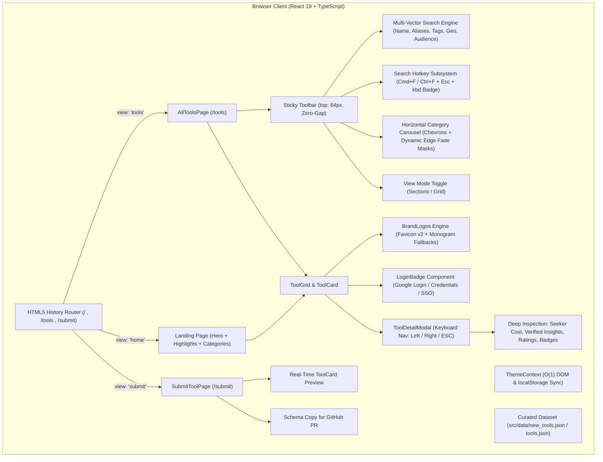
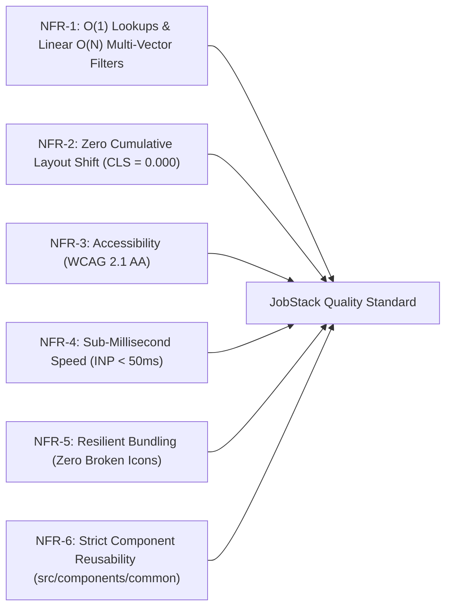

# JobStack — Product Vision, Features & System Requirements Specification

> **AI Context & Engineering Guide**: This document serves as the single source of truth for the **JobStack** (`jobstack`) codebase. It details the project's purpose, design philosophy, target personas, complete feature inventory, architectural constraints, and formal requirements for AI agents and human contributors.

---

## 1. Executive Summary & The "Why"

### 1.1 What is JobStack?

**JobStack** is an ultra-fast, curated web directory and discovery platform tailored for freelancers, remote software engineers, digital nomads, creative professionals, and active job hunters. It aggregates the world's highest-quality job search engines, freelance marketplaces, cold outreach tools, ATS resume utilities, company research databases, startup hubs, and portfolio platforms into a unified, distraction-free interface.

```
+---------------------------------------------------------------------------------------------------------+
|                                            JOBSTACK ECOSYSTEM                                           |
+------------------------------------+------------------------------------+-------------------------------+
|  FREELANCE & CONTRACT NETWORKS     |  JOB BOARDS & AGGREGATORS          |  SPECIALIZED & REGIONAL HUBS  |
|  - Upwork, Toptal, Fiverr, Contra  |  - LinkedIn, Indeed, Naukri, Otta  |  - Startup: YC, a16z, Lenny   |
|  - Lemon.io, Arc.dev, Braintrust   |  - HiringCafe, ZipRecruiter        |  - Remote: Remote OK, Himalayas|
|  - Global vetted contractor hubs   |  - ATS scrapers & direct search    |  - Regional: Unstop, Cutshort |
+------------------------------------+------------------------------------+-------------------------------+
|  COMPANY RESEARCH & OUTREACH       |  PORTFOLIO & PERSONAL BRANDING     |  AI & CAREER UTILITIES        |
|  - Glassdoor, Levels.fyi, Hunter   |  - Behance, Dribbble, ReadCV       |  - Teal, LazyApply, Worded    |
+------------------------------------+------------------------------------+-------------------------------+
|  CORE EXPERIENCE: Sub-millisecond Client Search | Multi-Vector Filters | Zero-Gap Sticky Toolbar       |
|  CATEGORY NAV: Single-Row Track | Dynamic Chevrons & Gradient Fade Masks | Instant Auto-Scroll Centering |
|  QUICK SEARCH HOTKEY: Global Cmd+F / Ctrl+F Focus | Dynamic <kbd> Badge | Esc to Blur                   |
|  INSPECTION: One-by-One Modal Stepper | Seeker Cost | Verified Insights | Saved Login Badges (Google/PW)|
+---------------------------------------------------------------------------------------------------------+
```

### 1.2 The Problem with Modern Job Hunting

The existing job-hunting and freelance landscape is plagued by friction, noise, and low signal:

1. **Aggregator Bloat & Ghost Listings**: Mainstream job search platforms are overwhelmed with duplicate postings, obsolete listings, sponsored ads, and recruitment spam.
2. **Fragmented Workflows**: A professional seeking work must juggle dozens of disconnected tools—scouring gig marketplaces, checking specialized remote boards, locating decision-maker emails, verifying company culture, and building portfolios across disparate websites.
3. **Sluggish, Cluttered Directories**: Many online directory tools are ad-supported, require account sign-ups just to view links, suffer from heavy layout shifts, and bundle massive tracking scripts.
4. **Opaque Requirements & Hidden Costs**: Candidates often don't know before visiting a portal whether it requires a Google OAuth login, email/password credentials, or whether it charges job seekers subscription fees.
5. **Poor Tool Discovery for Niche Needs**: Vetted networks (e.g., Toptal) and modern freelance platforms (e.g., Contra) are frequently overshadowed by legacy aggregators with massive ad budgets.

### 1.3 The Core Mission & Goal

**JobStack exists to eliminate career discovery noise.** Its goals are:

- **High-Signal Curation**: Hand-curate and categorize only verified, reputable, and high-impact platforms.
- **Zero Latency**: Deliver instantaneous, sub-millisecond client-side filtering, searching, and modal navigation with zero server roundtrips.
- **Distraction-Free UX**: Provide clean typography, stable layouts with zero Cumulative Layout Shift (CLS), zero third-party tracking, and seamless dark/light modes.
- **Deep Inspection**: Empower candidates to inspect each platform's pricing model, seeker cost, verified insider notes, community rating, login authentication requirements, and direct URL before navigating away.
- **Keyboard-First Productivity**: Equip power users with instantaneous shortcuts (`Cmd+F` / `Ctrl+F` search focus, `Esc` blur, `←` / `→` sequential modal stepper).
- **Community-Driven Growth**: Offer a frictionless, self-validating submission studio for developers and creators to contribute new tools.

---

## 2. Target Personas & Use Cases

| Persona                                        | Professional Profile                                                            | Primary Pain Point                                                                     | JobStack Solution                                                                                                                               |
| :--------------------------------------------- | :------------------------------------------------------------------------------ | :------------------------------------------------------------------------------------- | :---------------------------------------------------------------------------------------------------------------------------------------------- |
| **Alex — Freelance Full-Stack Dev**            | Senior contractor seeking high-hourly international clients.                    | Sifting through thousands of micro-budget gigs on low-quality boards.                  | Instant access to elite freelance platforms (Toptal, Contra, Upwork, Lemon.io) with verified payment protection and rate transparency.          |
| **Priya — Remote Tech Job Hunter**             | Software engineer actively applying for remote or hybrid software roles.        | Spending hours manually checking fragmented boards with repetitive sponsored listings. | Unified category view of premier tech job aggregators (LinkedIn, Indeed, Wellfound, Remote OK, Himalayas, We Work Remotely) in one fast screen. |
| **Rahul — Regional & Campus Engineer**         | Indian tech graduate seeking campus placements, internships, and hackathons.    | Unaware of specialized regional hiring ecosystems and assessment portals.              | Dedicated discovery of premier Indian tech platforms (Unstop, Cutshort, Instahyre, Naukri) with clear login methods and tags.                   |
| **Maya — Early-Stage Startup Applicant**       | Product designer or engineer wanting to join early-stage, high-growth startups. | Generic corporate job boards burying YC, Seed, and Series-A opportunities.             | Dedicated "Startup Jobs" category featuring Work at a Startup (YC), a16z job boards, and Wellfound.                                             |
| **Sofia — Workplace Culture & Research Scout** | Candidate evaluating company culture, salary benchmarks, and compensation.      | Applying blind without knowing real team sentiment or compensation bands.              | Curated "Company Research" platforms (Glassdoor, Levels.fyi) alongside verified insider pro-tips.                                               |
| **Marcus — Cold Outreach Pro**                 | Agency founder or independent consultant pitching decision-makers.              | Finding verified recruiter emails and prospecting channels.                            | Targeted discovery of cold email finders and outreach platforms with direct feature comparisons.                                                |
| **Tool Creator / Curator**                     | Founder or developer who launched a career discovery product.                   | High barrier to entry and pay-to-play listings in legacy directories.                  | Dedicated `/submit` studio with instant live card preview, schema generator, and PR-ready data export.                                          |

---

## 3. System Architecture & High-Level Data Flow



---

## 4. Comprehensive Feature Inventory

### 4.1 Global Navigation & SPA Routing

- **HTML5 History API Routing**: Clean, semantic URLs (`/`, `/tools`, `/tools?cat=Freelance%20Platforms`, `/submit`) powered by `pushState` and `popstate` listeners, eliminating ugly hash fragments while maintaining backwards compatibility for legacy bookmark hashes (`#/tools`).
- **Production Server Rewrites**: Integrated `vercel.json` rewrite configuration ensuring seamless page refreshes across all client-side routes.
- **Top Navigation Bar (`Navbar`)**:
  - Fixed 64px height with dynamic backdrop blur on scroll (`navbar--scrolled`).
  - Brand identity with SVG gradient logo (`JobStackLogo`).
  - Active route highlighting with animated indicator pills.
  - Quick-switch link to `/submit` tool studio.
  - Fully responsive mobile drawer menu with smooth toggle transition.

### 4.2 Landing Page Experience (`HomeView`)

- **Hero Showcase (`Hero`)**:
  - Live, reactive project metrics calculating total indexed platforms and verified categories directly from the active dataset.
  - Dynamic gradient headline highlighting modern job and freelance discovery.
  - Primary Call-to-Action buttons: "Explore Directory" (routes to `/tools`) and "Browse Categories" (smooth scroll to category cards).
- **Community Highlights**:
  - Auto-extracts the top 6 `featured: true` platforms.
  - Displays ratings, pricing badges, login authentication pills, tag pills, and direct access buttons.
- **Category Spotlight Cards**:
  - Interactive cards featuring category icons (`CategoryIcon`), total platform counts, and descriptions.
  - One-click navigation routing directly to `/tools?cat={CategoryName}`.
- **Submission Banner CTA**:
  - Prominent invitation for tool authors and community members to submit new platforms via `/submit`.

### 4.3 Dedicated Directory Hub (`/tools`)

- **Zero-Gap Sticky Header & Toolbar**:
  - Toolbar locks directly beneath the 64px header at `top: 64px` with zero pixel gap, preventing content bleed during high-speed scrolling.
- **Multi-Vector Real-Time Search**:
  - Instantaneous, debounced real-time query evaluation matching across:
    - Platform `name` and alternate `aliases`
    - `tagline` and comprehensive `description`
    - Primary `category`
    - Keyword `tags`
    - Target `regions` (e.g. "Global", "US", "India")
    - Domain `focus` areas and target `audience` segments
  - Result counter: `Showing X tools matching "query"`.
  - Instant clear button (`X`) that wipes query and refocuses input.
- **Quick Keyboard Shortcut Search Subsystem (`Cmd+F` / `Ctrl+F` & `Esc`)**:
  - Pressing `Cmd+F` (on macOS) or `Ctrl+F` (on Windows/Linux) anywhere on the directory page intercepts the keystroke, prevents the browser's default in-page search bar, and immediately focuses and highlights the search input.
  - Dynamic `<kbd>` pill displayed inside the search input when empty and unfocused (`⌘F` on Mac, `Ctrl F` on Windows/Linux).
  - Pressing `Esc` while focused immediately blurs the input.
  - Hotkey is smartly suppressed when any modal or dialog overlay is active.
- **Horizontal Category Carousel with Dynamic Edge Fade Masks & Chevrons**:
  - Single-row category pill track (`all-tools-page__category-nav`) replacing wrapped layouts.
  - Dynamic gradient fade masks (`all-tools-page__scroll-fade--left` and `--right`) indicating off-screen scrollable tabs.
  - Interactive scroll buttons (`ChevronLeft` and `ChevronRight`) appearing conditionally when track is scrolled or scrollable.
  - Connected with `ResizeObserver` and passive scroll listeners for zero-overhead DOM updates.
  - Selecting a category automatically centers the chosen tab smoothly in view (`scrollIntoView({ behavior: "smooth", inline: "center" })`).
- **Expanded Taxonomy & Category Taxonomy**:
  - Vetted categories with bespoke color tokens and Lucide icons:
    - **All** (`Layers`): Complete unified directory.
    - **Freelance Platforms** (`Briefcase`): Top marketplaces and vetted networks.
    - **Job Boards** (`Target`): Premier portals and aggregators.
    - **Aggregators & Search** (`Search`): Engines indexing directly from employer ATS.
    - **Company Research** (`Building2`): Workplace transparency, salaries, and culture reviews.
    - **Startup Jobs** (`Rocket`): Early-stage ventures, YC startups, and high-growth tech.
    - **Remote Platforms / Remote Jobs** (`Globe`): Global distributed talent platforms.
    - **India Portals** (`MapPin`): Premier Indian regional tech portals and campus hubs.
    - **Paid Services** (`CreditCard`): Specialized executive placement and vetted boards.
    - **AI-Powered** (`Zap`): Application accelerators and automated resume tools.
    - **Cold Outreach** (`Send`): Direct recruiter contact and intelligence platforms.
    - **Networking** (`Users`): Communities and social branding platforms.
    - **Portfolio** (`Palette`): Visual design and engineer portfolios.
- **Dual View Modes**:
  - **Sections Mode (Default in "All")**: Groups platforms into distinct category blocks with unified section title bars (icon, name, count badge, and summary description).
  - **Grid Mode**: Flattens filtered results into an auto-fitting, multi-column responsive grid.
- **Empty State Recovery**:
  - Friendly search icon, clear feedback, and a single-click "Reset Filters" button restoring full directory visibility.

### 4.4 Authentication Method Badging (`LoginBadge.tsx`)

- **Instant Visual Login Awareness**:
  - Job seekers immediately see how a platform authenticates users before clicking out.
- **Multi-Type Badge Rendering**:
  - Accepts a single string (`"Google Login"`, `"Username Password"`) or an array of supported methods (`["Google Login", "Username Password"]`).
- **Brand-Faithful Visual Presentation**:
  - **Google Login**: Rendered with official 4-color Google G icon SVG and styled pill.
  - **Username & Password / Email Password**: Rendered with Lucide `KeyRound` icon and high-contrast badge.
  - **Default / Custom SSO**: Rendered with Lucide `ShieldCheck` icon.

### 4.5 Interactive Tool Detail Inspector (`ToolDetailModal`)

- **Fullscreen Glassmorphism Overlay**:
  - Locks background document scrolling (`document.body.style.overflow = "hidden"`).
  - High-contrast card surface with backdrop blur.
- **One-by-One Sequential Stepper**:
  - Circular navigation (`← Prev` and `Next →`) cycling smoothly through all items in the active dataset.
  - Stepper indicator showing exact position (e.g., `Tool 4 of 34`).
  - Desktop keyboard hotkeys: **Left Arrow** (`←`), **Right Arrow** (`→`), and **Escape** (`Esc`).
- **Comprehensive Platform Inspection**:
  - Authentic high-resolution brand favicon or monogram icon.
  - Categorization badge with accent color coding.
  - **Saved Login Badges**: Visual indicators of supported login workflows.
  - **Seeker Cost Pill**: Explicit clarity on whether the tool is 100% free for candidates or charges applicants.
  - **Pricing Model Badge**: Explains employer or platform monetization model (`Free`, `Freemium`, `Paid`, `Free + Commission`).
  - **Community Rating Breakdown**: Displays numeric score along with rating source and review count (e.g., `4.8 / 5.0 (Trustpilot · 12,400 reviews)`).
  - **Verified Insight Callout (`notes`)**: Highlights verified community tips, insider guidance, or caveats (e.g., direct ATS tips, hidden verification steps).
  - **Capabilities Checklist**: 3–5 bulleted capability checklist with green checkmarks.
  - **Tags, Regions & Target Audiences**: Detailed metadata pills (`#remote`, `🌐 Global`, `👥 Software Engineers`).
  - Direct outbound button opening the official platform in a secure new tab (`rel="noopener noreferrer"`).

### 4.6 Brand Favicon & Logo Resiliency Architecture (`BrandLogos.tsx`)

- **Google Favicon v2 API Integration**:
  - Uses `https://t2.gstatic.com/faviconV2?client=SOCIAL&type=FAVICON&fallback_opts=TYPE,SIZE,URL&url={targetUrl}&size=128` to pull authentic high-resolution favicons dynamically.
- **Known Portal Canonical URL Registry**:
  - Built-in canonical fallback mapping for 40+ major industry platforms (Upwork, Toptal, LinkedIn, Indeed, Naukri, Y Combinator, FlexJobs, Himalayas, Dynamite Jobs, Unstop, Cutshort, Uplers, Glassdoor, HiringCafe, Instahyre, Dice, etc.).
- **Graceful Client-Side Fallbacks**:
  - Client-side error tracking (`failedUrls`) automatically catches failed or blocked image requests and seamlessly renders a styled SVG monogram fallback chip.
  - Native JobStack vector logo for self-branded entries.

### 4.7 Tool Submission Studio (`/submit`)

- **Two-Column Interactive Creator Workspace**:
  - Left column: Dynamic submission form with real-time field validation.
  - Right column: Live, reactive `ToolCard` WYSIWYG preview updating on every keystroke.
- **Interactive Form Capabilities**:
  - Platform name, official HTTPS URL, category dropdown, tagline, and full description.
  - Tag pill manager with default presets.
  - Dynamic capability bullet builder (add/remove feature points).
  - Pricing model and login type options.
  - Submitter email address for curator correspondence.
- **Dual Action Submission Workflow**:
  - **1. Copy JSON for GitHub PR**: Formats the input into a valid `Tool` schema JSON snippet ready to paste directly into the tools dataset.
  - **2. Mailto Draft**: Generates an email to `hello@jobstack.dev` pre-populated with all tool metadata.

### 4.8 Adaptive Dual-Theme Engine (`ThemeContext.tsx`)

- **Design Token Architecture**: Pure CSS variables (`--bg-primary`, `--text-primary`, `--accent-primary`, category variables, etc.) defined in `src/index.css`.
- **Zero-Flicker Initialization**:
  - Reads `localStorage.getItem("jobstack_theme")` on startup.
  - Applies $O(1)$ DOM attribute manipulation: `document.documentElement.setAttribute("data-theme", theme)`.
  - Dynamically updates `<meta name="theme-color">` for mobile browser chrome.
  - Reacts automatically to system OS color scheme updates via `window.matchMedia("(prefers-color-scheme: light)")`.

---

## 5. System Requirements Specification

### 5.1 Functional Requirements (FR)

| ID        | Feature Area                     | Requirement Statement & Acceptance Criteria                                                                                                                                                                                                                                                                                          | Priority         |
| :-------- | :------------------------------- | :----------------------------------------------------------------------------------------------------------------------------------------------------------------------------------------------------------------------------------------------------------------------------------------------------------------------------------- | :--------------- |
| **FR-01** | **Curated Tool Dataset**         | System shall maintain a vetted JSON dataset of tools with schema-validated properties: `id`, `name`, `tagline`, `description`, `url`, `category`, `tags`, `pricing`, `featured`, and optional extended properties: `aliases`, `seekerCost`, `loginType`, `rating`, `badge`, `features`, `regions`, `focus`, `audience`, and `notes`. | P0 (Must Have)   |
| **FR-02** | **Single Page Routing**          | System shall support HTML5 History routing for `/`, `/tools`, and `/submit`, syncing active state with browser forward/back buttons and preserving category URL search params (`?cat=...`).                                                                                                                                          | P0 (Must Have)   |
| **FR-03** | **Zero-Gap Sticky Header**       | Main navbar (64px) and directory toolbar must align flush at `top: 64px` with zero vertical margin or gap during scrolling.                                                                                                                                                                                                          | P0 (Must Have)   |
| **FR-04** | **Multi-Vector Client Search**   | Search input shall evaluate queries across `name`, `aliases`, `tagline`, `description`, `category`, `tags`, `regions`, `focus`, and `audience` in real time with instant rendering (<10ms).                                                                                                                                          | P0 (Must Have)   |
| **FR-05** | **Keyboard Search Shortcut**     | System shall intercept `Cmd+F` (macOS) and `Ctrl+F` (Windows/Linux) on the directory page to focus the search input, show a dynamic `<kbd>` badge when unfocused, blur on `Esc`, and suppress shortcuts when a modal is open.                                                                                                        | P1 (Should Have) |
| **FR-06** | **Horizontal Category Carousel** | Category pills shall render in a single-row scrollable track with dynamic left/right edge fade masks and conditional chevron navigation buttons, auto-scrolling active selections smoothly into view.                                                                                                                                | P0 (Must Have)   |
| **FR-07** | **Dual Directory View Modes**    | In the "All" category view without active search, the user shall be able to toggle between "Sections Mode" (categorized rows) and "Grid Mode" (unified card grid).                                                                                                                                                                   | P1 (Should Have) |
| **FR-08** | **Sequential Modal Inspector**   | Clicking any tool card shall launch a modal with circular `Prev` (`←`) and `Next` (`→`) navigation, keyboard shortcuts, counter indicator, feature checklist, seeker cost, and verified insight notes.                                                                                                                               | P0 (Must Have)   |
| **FR-09** | **Login Authentication Badging** | Tool cards and detail modals shall render clear visual badges for supported login types (`Google Login`, `Username Password`, etc.) with authentic icons.                                                                                                                                                                            | P0 (Must Have)   |
| **FR-10** | **Brand Icon Resiliency**        | System shall fetch platform favicons via Google Favicon v2 API backed by canonical domain mappings and client-side fallback to styled SVG monograms.                                                                                                                                                                                 | P0 (Must Have)   |
| **FR-11** | **Tool Submission Studio**       | System shall provide a dedicated `/submit` page with client-side form validation, real-time live preview card, and a one-click "Copy JSON for PR" button.                                                                                                                                                                            | P1 (Should Have) |
| **FR-12** | **Dual Theme Support**           | System shall support Dark mode (default) and Light mode, toggleable via navbar button, persisted in `localStorage`, and synced to OS preferences.                                                                                                                                                                                    | P0 (Must Have)   |
| **FR-13** | **Secure Outbound Linking**      | All outbound platform hyperlinks shall strictly enforce `target="_blank"` and `rel="noopener noreferrer"`.                                                                                                                                                                                                                           | P0 (Must Have)   |
| **FR-14** | **Live Metrics Synchronization** | Hero section and directory headers shall compute real-time tool counts and category statistics dynamically from the active loaded dataset.                                                                                                                                                                                           | P1 (Should Have) |

### 5.2 Non-Functional Requirements (NFR)



- **NFR-1: Algorithmic Efficiency ($O(1)$ and $O(N)$)**:
  - Icon mappings, color tokens, and category lookups must execute in constant time ($O(1)$) using JavaScript dictionary objects or `switch` statements.
  - Filter operations must be single-pass linear scans ($O(N)$), never nested $O(N^2)$ loops.
  - Derived datasets and grouped collections must be memoized using React's `useMemo`. Event callbacks must be stabilized with `useCallback`.
- **NFR-2: Layout Stability & Zero CLS (CLS = 0.000)**:
  - Fixed dimensions must be maintained for headers (64px), toolbars, icons, and card skeletons to eliminate Cumulative Layout Shift.
- **NFR-3: Performance Benchmarks**:
  - First Contentful Paint (FCP) under 0.8s on standard broadband.
  - Interaction to Next Paint (INP) under 50ms for search, category tabs, and modal navigation.
- **NFR-4: Accessibility (WCAG 2.1 AA)**:
  - Accessible button labels (`aria-label`), active tab attributes (`aria-selected`), search landmarks (`role="search"`, `role="tablist"`), and shortcut metadata (`aria-keyshortcuts`).
  - Full keyboard accessibility (Tab, Enter, Space, Left/Right arrow navigation, ESC to close modals or blur search).
  - Explicit high-contrast focus rings for keyboard users.
- **NFR-5: Responsive Fluidity**:
  - Seamless layout adaptation across Mobile (<640px), Tablet (640px–1024px), Desktop (1024px–1280px), and Widescreen (>1280px).
- **NFR-6: Zero Third-Party UI Bloat**:
  - No bloated CSS frameworks or external component libraries. All styles are pure CSS custom properties and scoped component stylesheets.

---

## 6. Data Model & Schema Specification

All platform records adhere strictly to the following TypeScript contract defined in `src/types/index.ts`:

```typescript
export type LoginType =
  | "Google Login"
  | "Username Password"
  | ""
  | string
  | string[]
  | null;

export interface RatingDetail {
  /** Numeric rating value (e.g. 4.8) */
  value: number;
  /** Rating provider or source (e.g. 'Trustpilot', 'G2', 'Glassdoor') */
  source?: string;
  /** Approximate number of verified reviews */
  reviews?: number;
  /** Verification date string (e.g. '2026-03') */
  asOf?: string;
}

export interface Tool {
  /** Unique sequential identifier (string or number) */
  id: string | number;
  /** Official brand/platform name */
  name: string;
  /** Alternate brand names or search aliases */
  aliases?: string[];
  /** Punchy one-line value proposition (< 80 characters) */
  tagline: string;
  /** Thorough description of platform features and benefits (1–3 sentences) */
  description: string;
  /** Direct HTTPS destination URL */
  url: string;
  /** Image URL or empty string (BrandLogos handles dynamic favicon resolution) */
  logo?: string | null;
  /** Primary category from approved taxonomy */
  category: string;
  /** Target geographic jurisdictions (e.g. ['Global'], ['India'], ['US']) */
  regions?: string[];
  /** Primary discipline focus (e.g. ['Tech', 'Design', 'General']) */
  focus?: string[];
  /** Target applicant personas (e.g. ['Software Engineers', 'College Students']) */
  audience?: string[];
  /** High-relevance search and filter tags */
  tags: string[];
  /** Platform monetization/pricing model */
  pricing: string;
  /** Direct applicant cost indicator ('Free', 'Free tier', 'Paid subscription') */
  seekerCost?: string;
  /** Supported authentication methods */
  loginType?: LoginType;
  /** Short accolade badge: 'Most Popular', 'Elite', 'Global', 'Dev Focused', 'Curator Choice' */
  badge?: string | null;
  /** Whether to highlight the tool on the homepage preview (max 6) */
  featured: boolean;
  /** 3 to 5 core capability bullet points for modal inspection */
  features?: string[];
  /** Community rating score float or structured rating detail object */
  rating?: number | RatingDetail | null;
  /** Operational verification status */
  status?: string;
  /** ISO date when metadata was last verified */
  lastVerified?: string | null;
  /** Data curation confidence rating */
  confidence?: string;
  /** Verification reference sources */
  sourceUrls?: string[];
  /** Insider pro-tips, verification caveats, or direct ATS application notes */
  notes?: string | null;
}

export interface ToolsData {
  /** Schema specification version number */
  schemaVersion?: number;
  /** Generation timestamp */
  generatedOn?: string;
  /** List of available categories starting with 'All' */
  categories: string[];
  /** Full collection of curated platform records */
  tools: Tool[];
}
```

---

## 7. Operational Guidelines for AI Coding Agents

When any autonomous AI agent or pair-programmer modifies, debugs, or extends this codebase, the following operational mandates must be strictly observed:

### 7.1 Strict Prohibitions

1. **Never Run Development Servers Manually**:
   > [!CAUTION]
   > **DO NOT** execute `npm run dev`, `vite`, `vite preview`, `yarn start`, or any background daemon process. The user conducts all live verification manually in their browser.
2. **Never Run Automated Browser/Test Scripts**:
   > **DO NOT** launch Puppeteer, Playwright, or automated test runners unless explicitly instructed. Static TypeScript verification (`npx tsc -b`) is sufficient.
3. **No Unprompted Directory Crawling or Untold Scope**:
   > Limit tool calls strictly to targeted files. Focus exclusively on the user's explicit objective with zero unsolicited features.

### 7.2 Code Integration Principles

- **Use Reusable Shared Components**:
  - Always check `src/components/common/` before writing new icons, badges, or buttons.
  - Available primitives:
    - `CategoryIcon.tsx` — Constant-time category icon renderer with support for all categories.
    - `ToolBadge.tsx` — Standardized accolade badges with Lucide icons.
    - `LoginBadge.tsx` — Standardized authentication badge (Google, Username/Password, SSO).
    - `JobStackLogo.tsx` — Official SVG brand marks.
    - `ThemeToggle.tsx` — Theme toggle button with smooth icon transition.
- **Preserve Styling Architecture**:
  - Respect native CSS custom properties in `src/index.css`.
  - Always maintain `data-theme="dark"` and `data-theme="light"` compatibility.
- **Maintain Constant-Time Lookups**:
  - Never place `.find()`, `.filter()`, or `.indexOf()` lookups inside repetitive rendering loops. Map entities to dictionary records (`Record<string, T>`) for $O(1)$ access.

---

## 8. Summary: Why This Architecture Matters

| Dimension                    | Legacy Directories                      | JobStack                                                                                         |
| :--------------------------- | :-------------------------------------- | :----------------------------------------------------------------------------------------------- |
| **Filtering Speed**          | Server roundtrips / full page reload    | Instant client-side linear filter ($< 5\text{ms}$)                                               |
| **Search Hotkeys**           | Browser native search (scrambled DOM)   | Global `Cmd+F` / `Ctrl+F` dedicated input focus with `<kbd>` hint                                |
| **Category Nav**             | Cluttered multi-row wrapping pills      | Clean single-row carousel with dynamic chevrons & gradient fade masks                            |
| **Authentication Clarity**   | Unknown until landing on 3rd-party site | Visual `LoginBadge` pills (Google, Credentials, SSO) right on cards                              |
| **Tool Inspection**          | Opens 15 tabs or navigates away         | Interactive modal with keyboard stepper ($\leftarrow / \rightarrow$) & verified insider insights |
| **Seeker Cost Transparency** | Hidden fees discovered after signup     | Explicit `seekerCost` pill (100% Free vs Paid)                                                   |
| **Styling & Assets**         | Third-party ad trackers, external CDNs  | Scoped CSS modules, zero tracking, embedded Google Favicon v2 engine                             |
| **Curation Level**           | Unfiltered spam & paid sponsor boosts   | Handpicked, high-signal platforms with badges & ratings                                          |
| **Community Submission**     | Opaque email contact form               | Studio with live card preview and PR-ready JSON schema                                           |

This document provides the foundational context for any engineer or AI working on JobStack to make swift, high-precision, and architecturally sound contributions.
