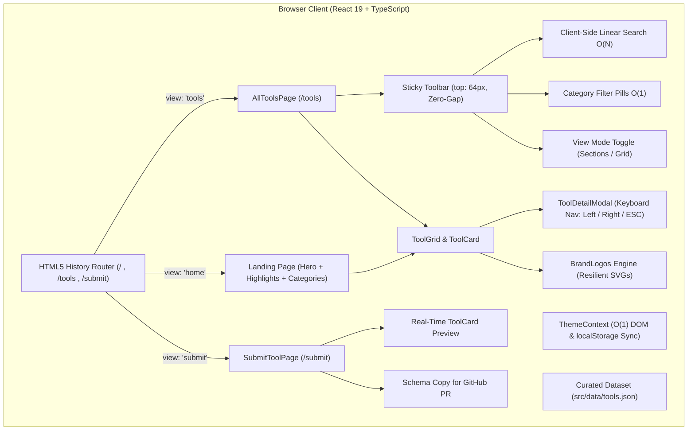
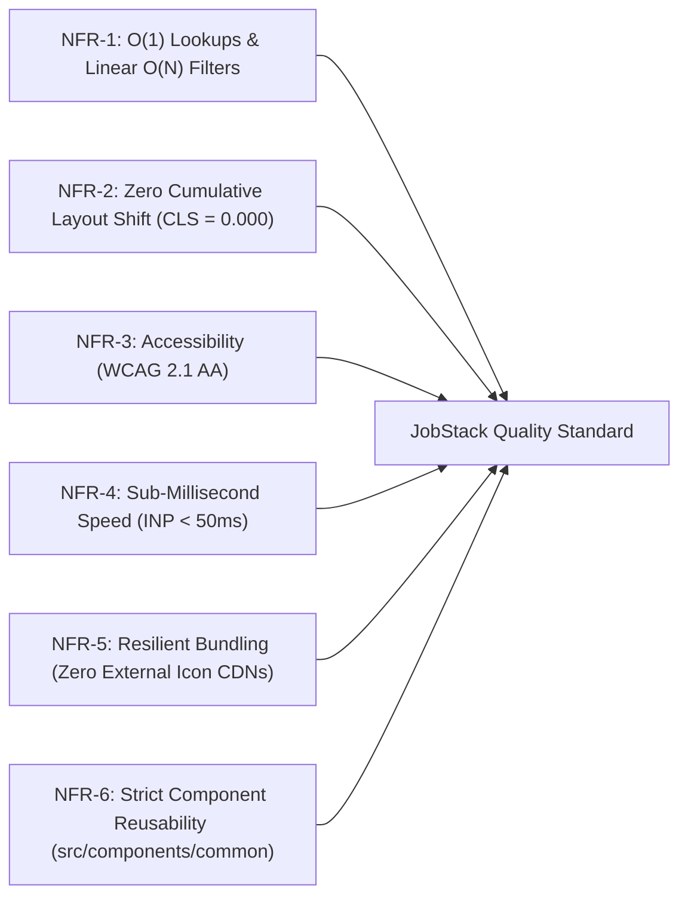

# JobStack — Product Vision, Features & System Requirements Specification

> **AI Context & Engineering Guide**: This document serves as the single source of truth for the **JobStack** (`jobstack`) codebase. It details the project's purpose, design philosophy, target personas, complete feature inventory, architectural constraints, and formal requirements for AI agents and human contributors.

---

## 1. Executive Summary & The "Why"

### 1.1 What is JobStack?

**JobStack** is an ultra-fast, curated web directory and discovery platform tailored for freelancers, remote software engineers, digital nomads, creative professionals, and active job hunters. It aggregates the world's highest-quality job search engines, freelance marketplaces, cold outreach tools, ATS resume utilities, and portfolio platforms into a unified, distraction-free interface.

```
+--------------------------------------------------------------------------------------------------+
|                                         JOBSTACK ECOSYSTEM                                       |
+------------------------------------+-------------------------------------+-----------------------+
|  FREELANCE PLATFORMS               |  JOB BOARDS                         |  PORTFOLIO & CAREER   |
|  - Upwork, Toptal, Fiverr, Contra  |  - LinkedIn, Naukri, Indeed, Remote |  - GitHub, Behance,   |
|  - Silicon Valley contract hubs    |    OK, Wellfound, Otta, We Work Rem.|    Dribbble, ReadCV   |
+------------------------------------+-------------------------------------+-----------------------+
|  CORE EXPERIENCE: Sub-millisecond Client Search | O(1) Lookups | Zero-Gap Sticky Toolbar         |
|  INSPECTION: One-by-One Modal Stepper | Dark/Light Engine | Tool Submission Studio with Preview   |
+--------------------------------------------------------------------------------------------------+
```

### 1.2 The Problem with Modern Job Hunting

The existing job-hunting and freelance landscape is plagued by friction, noise, and low signal:

1. **Aggregator Bloat & Ghost Listings**: Mainstream job search platforms are overwhelmed with duplicate postings, obsolete listings, sponsored ads, and recruitment spam.
2. **Fragmented Workflows**: A professional seeking work must juggle dozens of disconnected tools—scouring gig marketplaces, checking specialized remote boards, locating decision-maker emails, and building portfolios across disparate websites.
3. **Sluggish, Cluttered Directories**: Many online directory tools are ad-supported, require account sign-ups just to view links, suffer from heavy layout shifts, and bundle massive tracking scripts.
4. **Poor Tool Discovery for Niche Needs**: Vetted networks (e.g., Toptal) and modern freelance platforms (e.g., Contra) are frequently overshadowed by legacy aggregators with massive ad budgets.

### 1.3 The Core Mission & Goal

**JobStack exists to eliminate career discovery noise.** Its goals are:

- **High-Signal Curation**: Hand-curate and categorize only verified, reputable, and high-impact platforms.
- **Zero Latency**: Deliver instantaneous, sub-millisecond client-side filtering, searching, and modal navigation with zero server roundtrips.
- **Distraction-Free UX**: Provide clean typography, stable layouts with zero Cumulative Layout Shift (CLS), zero third-party tracking, and seamless dark/light modes.
- **Deep Inspection**: Empower candidates to inspect each platform's pricing model, key capabilities, community reputation, and direct URL before navigating away.
- **Community-Driven Growth**: Offer a frictionless, self-validating submission studio for developers and creators to contribute new tools.

---

## 2. Target Personas & Use Cases

| Persona                             | Professional Profile                                                     | Primary Pain Point                                                                     | JobStack Solution                                                                                                            |
| :---------------------------------- | :----------------------------------------------------------------------- | :------------------------------------------------------------------------------------- | :--------------------------------------------------------------------------------------------------------------------------- |
| **Alex — Freelance Full-Stack Dev** | Senior contractor seeking high-hourly international clients.             | Sifting through thousands of micro-budget gigs on low-quality boards.                  | Instant access to elite freelance platforms (Toptal, Contra, Upwork) with verified payment protection and rate transparency. |
| **Priya — Remote Tech Job Hunter**  | Software engineer actively applying for remote or hybrid software roles. | Spending hours manually checking fragmented boards with repetitive sponsored listings. | Unified category view of premier tech job aggregators (LinkedIn, Indeed, Naukri, Wellfound, Remote OK) in one fast screen.   |
| **Marcus — Cold Outreach Pro**      | Agency founder or independent consultant pitching decision-makers.       | Finding verified recruiter emails and prospecting channels.                            | Targeted discovery of cold email finders and outreach platforms with direct feature comparisons.                             |
| **Sofia — AI-Native Job Seeker**    | Modern candidate using automation to accelerate job applications.        | Inefficient manual resume formatting and ATS rejections.                               | Discovery of AI-powered resume analyzers and job application utilities to optimize submissions.                              |
| **Elena — UI/UX & Brand Designer**  | Visual designer wanting high-impact client showcases.                    | Generic resume sites that fail to highlight visual design work.                        | Curated portfolio directories (Behance, Dribbble, ReadCV) to publish work where hiring managers look.                        |
| **Tool Creator / Curator**          | Founder or developer who launched a career discovery product.            | High barrier to entry and pay-to-play listings in legacy directories.                  | Dedicated `/submit` studio with instant live card preview, schema generator, and PR-ready data export.                       |

---

## 3. System Architecture & High-Level Data Flow



---

## 4. Comprehensive Feature Inventory

### 4.1 Global Navigation & SPA Routing

- **HTML5 History API Routing**: Clean, semantic URLs (`/`, `/tools`, `/tools?cat=Freelance%20Platforms`, `/submit`) powered by `pushState` and `popstate` listeners, eliminating ugly hash fragments while maintaining full backwards compatibility for legacy bookmark hashes (`#/tools`).
- **Production Server Rewrites**: Integrated `vercel.json` rewrite configuration ensuring seamless page refreshes across all client-side routes.
- **Top Navigation Bar (`Navbar`)**:
  - Fixed 64px height with dynamic backdrop blur on scroll (`navbar--scrolled`).
  - Brand identity with SVG gradient logo (`JobStackLogo`).
  - Active route highlighting with animated pills.
  - Quick-switch link to `/submit` tool studio.
  - Fully responsive mobile drawer menu with smooth toggle transition.

### 4.2 Landing Page Experience (`HomeView`)

- **Hero Showcase (`Hero`)**:
  - Live, reactive project metrics calculating total indexed platforms and verified categories directly from data.
  - Dynamic gradient headline highlighting modern job and freelance discovery.
  - Primary Call-to-Action buttons: "Explore Directory" (routes to `/tools`) and "Browse Categories" (smooth scroll to category cards).
- **Community Highlights**:
  - Auto-extracts the top 6 `featured: true` platforms.
  - Displays ratings, pricing badges, tag pills, and direct access buttons.
- **Category Spotlight Cards**:
  - Interactive cards featuring category icons (`CategoryIcon`), total platform counts, and descriptions.
  - One-click navigation routing directly to `/tools?cat={CategoryName}`.
- **Submission Banner CTA**:
  - Prominent invitation for tool authors and community members to submit new platforms via `/submit`.

### 4.3 Dedicated Directory Hub (`/tools`)

- **Zero-Gap Sticky Header & Toolbar**:
  - Toolbar locks directly beneath the 64px header at `top: 64px` with zero pixel gap, preventing content bleed during high-speed scrolling.
- **Integrated Live Search**:
  - Instantaneous, debounced real-time query evaluation against tool names, taglines, descriptions, categories, and tags.
  - Inline clear button (`X`) and result counter (`Showing X tools matching "query"`).
- **Category Filter Pills**:
  - Horizontal scrollable/wrappable category badges showing real-time tool counts.
  - Empty categories with 0 tools are automatically pruned from active filters.
- **Dual View Modes**:
  - **Sections Mode (Default in "All")**: Groups platforms into distinct category blocks with unified section title bars (icon, name, count badge, and summary).
  - **Grid Mode**: Flattens filtered results into an auto-fitting, multi-column responsive grid.
- **Empty State Recovery**:
  - Friendly icon, clear error message, and a single-click "Reset Filters" button restoring full directory visibility.

### 4.4 Interactive Tool Detail Inspector (`ToolDetailModal`)

- **Fullscreen Glassmorphism Overlay**:
  - Locks background document scrolling (`document.body.style.overflow = "hidden"`).
  - High-contrast card surface with backdrop blur.
- **One-by-One Sequential Stepper**:
  - Circular navigation (`← Prev` and `Next →`) cycling smoothly through all items in the active dataset.
  - Stepper indicator showing exact position (e.g. `Tool 4 of 34`).
  - Desktop keyboard hotkeys: **Left Arrow** (`←`), **Right Arrow** (`→`), and **Escape** (`Esc`).
- **Comprehensive Platform Inspection**:
  - Authentic inline SVG brand logo.
  - Categorization badge with accent color coding.
  - Pricing model badge (`Free`, `Freemium`, `Paid`, `Free + Commission`).
  - User rating indicator with star graphics.
  - Full product description and 3–5 bulleted capability checklist with green checkmarks.
  - Direct outbound button opening the official platform in a secure new tab (`rel="noopener noreferrer"`).

### 4.5 Tool Submission Studio (`/submit`)

- **Two-Column Interactive Creator Workspace**:
  - Left column: Dynamic submission form with real-time field validation.
  - Right column: Live, reactive `ToolCard` WYSIWYG preview updating on every keystroke.
- **Interactive Form Capabilities**:
  - Platform name, official HTTPS URL, category dropdown, tagline, and full description.
  - Tag pill manager with default presets.
  - Dynamic capability bullet builder (add/remove feature points).
  - Submitter email address for curator correspondence.
- **Dual Action Submission Workflow**:
  - **1. Copy JSON for GitHub PR**: Formats the input into a valid `Tool` schema JSON snippet ready to paste directly into `src/data/tools.json`.
  - **2. Mailto Draft**: Generates an email to `hello@jobstack.dev` pre-populated with all tool metadata.

### 4.6 Brand Icon Resiliency System (`BrandLogos.tsx`)

- **Zero Third-Party Image Failures**:
  - Third-party CDNs (like Clearbit or Google Favicons) regularly fail, throttle, or get blocked by ad-blockers.
  - JobStack incorporates handcrafted, authentic SVG vector logos for core platforms: **LinkedIn**, **Naukri.com**, **Indeed**, **Upwork**, **Toptal**, **Fiverr**, **Wellfound**, **Remote OK**, **Behance**, **Dribbble**, **GitHub**, **ReadCV**, **Contra**, and others.
- **Graceful Fallbacks**:
  - For unmapped platforms, the system renders a styled SVG monogram using the first character of the tool's name or its category icon.

### 4.7 Adaptive Dual-Theme Engine (`ThemeContext.tsx`)

- **Design Token Architecture**: Pure CSS variables (`--bg-primary`, `--text-primary`, `--accent-primary`, etc.) defined in `src/index.css`.
- **Zero-Flicker Initialization**:
  - Reads `localStorage.getItem("jobstack_theme")` on startup.
  - Applies `$O(1)$` DOM attribute manipulation: `document.documentElement.setAttribute("data-theme", theme)`.
  - Dynamically updates `<meta name="theme-color">` for mobile browser chrome.
  - Reacts automatically to system OS color scheme updates via `window.matchMedia("(prefers-color-scheme: light)")`.

---

## 5. System Requirements Specification

### 5.1 Functional Requirements (FR)

| ID        | Feature Area                     | Requirement Statement & Acceptance Criteria                                                                                                                                                                                  | Priority         |
| :-------- | :------------------------------- | :--------------------------------------------------------------------------------------------------------------------------------------------------------------------------------------------------------------------------- | :--------------- |
| **FR-01** | **Curated Tool Directory**       | System shall maintain a vetted JSON dataset of tools with schema-validated properties: `id`, `name`, `tagline`, `description`, `url`, `category`, `tags`, `pricing`, `rating`, `featured`, `badge`, and optional `features`. | P0 (Must Have)   |
| **FR-02** | **Single Page Routing**          | System shall support HTML5 History routing for `/`, `/tools`, and `/submit`, syncing active state with browser forward/back buttons and preserving category URL search params (`?cat=...`).                                  | P0 (Must Have)   |
| **FR-03** | **Zero-Gap Sticky Header**       | Main navbar (64px) and directory toolbar must align flush at `top: 64px` with zero vertical margin or gap on scroll.                                                                                                         | P0 (Must Have)   |
| **FR-04** | **Real-Time Client Search**      | Search input shall filter the tools dataset in real time against `name`, `tagline`, `description`, `category`, and `tags` with instant rendering (<10ms).                                                                    | P0 (Must Have)   |
| **FR-05** | **Category Filtering**           | System shall permit filtering by approved categories. Categories with 0 tools shall be automatically excluded from active filter tabs.                                                                                       | P0 (Must Have)   |
| **FR-06** | **Dual Directory View Modes**    | In the "All" category view without active search, the user shall be able to toggle between "Sections Mode" (categorized rows) and "Grid Mode" (unified card grid).                                                           | P1 (Should Have) |
| **FR-07** | **Sequential Modal Inspector**   | Clicking any tool card shall launch a modal with circular `Prev` (`←`) and `Next` (`→`) navigation, keyboard shortcuts, counter indicator, and feature checklist.                                                            | P0 (Must Have)   |
| **FR-08** | **Tool Submission Studio**       | System shall provide a dedicated `/submit` page with client-side form validation, real-time live preview card, and a one-click "Copy JSON for PR" button.                                                                    | P1 (Should Have) |
| **FR-09** | **Dual Theme Support**           | System shall support Dark mode (default) and Light mode, toggleable via navbar button, persisted in `localStorage`, and synced to OS preferences.                                                                            | P0 (Must Have)   |
| **FR-10** | **Brand Icon Resiliency**        | System shall render custom inline SVGs for major platform brands with automatic fallback to monograms, avoiding broken external image links.                                                                                 | P0 (Must Have)   |
| **FR-11** | **Secure Outbound Linking**      | All outbound platform hyperlinks shall strictly enforce `target="_blank"` and `rel="noopener noreferrer"`.                                                                                                                   | P0 (Must Have)   |
| **FR-12** | **Live Metrics Synchronization** | Hero section and directory headers shall compute real-time tool counts and category statistics dynamically from the loaded dataset.                                                                                          | P1 (Should Have) |

### 5.2 Non-Functional Requirements (NFR)



- **NFR-1: Algorithmic Efficiency ($O(1)$ and $O(N)$)**:
  - Icon mappings, color tokens, and category lookups must execute in constant time ($O(1)$) using JavaScript dictionary objects or `Map`.
  - Filter operations must be single-pass linear scans ($O(N)$), never nested $O(N^2)$ loops.
  - Derived datasets and grouped collections must be memoized using React's `useMemo`. Event callbacks must be stabilized with `useCallback`.
- **NFR-2: Layout Stability & Zero CLS (CLS = 0.000)**:
  - Fixed dimensions must be maintained for headers (64px), toolbars, icons, and card skeletons to eliminate Cumulative Layout Shift.
- **NFR-3: Performance Benchmarks**:
  - First Contentful Paint (FCP) under 0.8s on standard broadband.
  - Interaction to Next Paint (INP) under 50ms for search, category tabs, and modal navigation.
- **NFR-4: Accessibility (WCAG 2.1 AA)**:
  - Accessible button labels (`aria-label`), active tab attributes (`aria-selected`), and semantic landmark tags (`<nav>`, `<main>`, `<section>`, `<dialog>`).
  - Full keyboard accessibility (Tab, Enter, Space, Left/Right arrow navigation, ESC to close modals).
  - Explicit high-contrast focus rings for keyboard users.
- **NFR-5: Responsive Fluidity**:
  - Seamless layout adaptation across Mobile (<640px), Tablet (640px–1024px), Desktop (1024px–1280px), and Widescreen (>1280px).
- **NFR-6: Zero Third-Party UI Bloat**:
  - No bloated CSS frameworks or component libraries (e.g. Tailwind, Bootstrap, MUI). All styles are pure CSS custom properties and scoped component stylesheets.

---

## 6. Data Model & Schema Specification

All platform records reside in `src/data/tools.json` and must adhere strictly to the following TypeScript contract:

```typescript
export interface Tool {
  /** Unique sequential positive integer */
  id: number;
  /** Official brand/platform name */
  name: string;
  /** Punchy one-line value proposition (< 80 characters) */
  tagline: string;
  /** Thorough description of platform features and benefits (1–3 sentences) */
  description: string;
  /** Direct HTTPS destination URL */
  url: string;
  /** Image URL or empty string (BrandLogos handles SVG rendering) */
  logo: string;
  /** Primary category from approved taxonomy */
  category: "Job Boards" | "Freelance Platforms" | "Portfolio" | string;
  /** High-relevance search and filter tags */
  tags: string[];
  /** Pricing structure: '100% Free', 'Freemium', 'Paid', 'Free + Commission', 'Free (Elite)' */
  pricing: string;
  /** Community rating float between 1.0 and 5.0 */
  rating: number;
  /** Whether to highlight the tool on the homepage preview (max 6) */
  featured: boolean;
  /** Short accolade badge: 'Most Popular', 'Elite', 'Global', 'Dev Focused', 'Curator Choice' */
  badge: string;
  /** 3 to 5 core capability bullet points for modal inspection */
  features?: string[];
}

export interface ToolsData {
  /** List of available categories starting with 'All' */
  categories: string[];
  /** Full collection of curated platform records */
  tools: Tool[];
}
```

---

## 7. Operational Guidelines for AI Coding Agents

When any autonomous AI agent or pair-programmer modifies, debugs, or extends this codebase, the following operational mandates must be strictly observed:

### 7.1 Strict Prohibitions

1. **Never Run Development Servers Manually**:
   > [!CAUTION]
   > **DO NOT** execute `npm run dev`, `vite`, `vite preview`, or any background daemon process. The user conducts all live verification manually in their browser.
2. **Never Run Automated Browser/Test Scripts**:
   > **DO NOT** launch Puppeteer, Playwright, or automated test runners unless explicitly instructed. Static TypeScript verification (`tsc -b`) is sufficient.
3. **No Unprompted Directory Crawling**:
   > Limit tool calls strictly to targeted files. Avoid sweeping searches across unrelated files.

### 7.2 Code Integration Principles

- **Use Reusable Shared Components**:
  - Always check `src/components/common/` before writing new icons, badges, or buttons.
  - Available primitives:
    - `CategoryIcon.tsx` — Constant-time category icon renderer.
    - `ToolBadge.tsx` — Standardized accolade badges with Lucide icons.
    - `JobStackLogo.tsx` — Official SVG brand marks.
    - `ThemeToggle.tsx` — Theme toggle button with smooth icon transition.
- **Preserve Styling Architecture**:
  - Respect native CSS custom properties in `src/index.css`.
  - Always maintain `data-theme="dark"` and `data-theme="light"` compatibility.
- **Maintain Constant-Time Lookups**:
  - Never place `.find()`, `.filter()`, or `.indexOf()` lookups inside repetitive rendering loops. Map entities to dictionary records (`Record<string, T>`) for $O(1)$ access.

---

## 8. Summary: Why This Architecture Matters

| Dimension                | Legacy Directories                     | JobStack                                                             |
| :----------------------- | :------------------------------------- | :------------------------------------------------------------------- |
| **Filtering Speed**      | Server roundtrips / full page reload   | Instant client-side linear filter ($< 5\text{ms}$)                   |
| **Tool Inspection**      | Opens 15 tabs or navigates away        | Interactive modal with keyboard stepper ($\leftarrow / \rightarrow$) |
| **Styling & Assets**     | Third-party ad trackers, external CDNs | Scoped CSS modules, zero tracking, embedded SVGs                     |
| **Curation Level**       | Unfiltered spam & paid sponsor boosts  | Handpicked, high-signal platforms with badges & ratings              |
| **Community Submission** | Opaque email contact form              | Studio with live card preview and PR-ready JSON schema               |

This document provides the foundational context for any AI working on JobStack to make swift, high-precision, and architecturally sound contributions.
