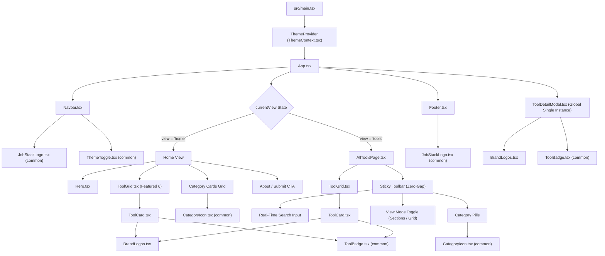

# JobStack — Project Structure & Architecture Guide

This document provides a comprehensive guide to the file structure, component architecture, data flow, and design system of the **JobStack** (`jobstack`) codebase.

---

## 1. Directory Tree Overview

```
job-tools/
├── AGENT.md                       # Operational rules and code integration guidelines for AI agents
├── JobStack.md                    # Project scenarios, requirements, and AI productivity guide
├── PROJECT_STRUCTURE.md           # This document: full architecture and file reference
├── README.md                      # Developer quick-start and project summary
├── index.html                     # HTML root entry point and initial meta tags
├── package.json                   # Dependencies, scripts, and package metadata
├── package-lock.json              # Deterministic lockfile for npm dependencies
├── tsconfig.json                  # Root TypeScript configuration references
├── tsconfig.app.json              # Client application TypeScript rules
├── tsconfig.node.json             # Vite configuration TypeScript rules
├── vite.config.ts                 # Vite bundler configuration and React plugin setup
├── eslint.config.js               # ESLint linting configuration
├── public/                        # Static assets served as-is
│   ├── favicon.ico                # JobStack browser tab favicon
│   └── vite.svg                   # Vite starter icon
└── src/                           # Main application source code
    ├── main.tsx                   # React 19 root entry point and ThemeProvider wrapping
    ├── App.tsx                    # Root orchestrator: hash routing, state, and view rendering
    ├── App.css                    # Home layout, featured preview, CTA banner, and section styles
    ├── index.css                  # CSS design tokens, dark/light themes, reset, and typography
    ├── types/
    │   └── index.ts               # Core TypeScript interfaces (Tool, ToolsData)
    ├── context/
    │   └── ThemeContext.tsx       # O(1) DOM theme synchronization and localStorage provider
    ├── data/
    │   └── tools.json             # Curated dataset of tools, categories, badges, and features
    ├── assets/
    │   ├── hero.png               # Hero section graphic illustration
    │   ├── react.svg              # React library logo
    │   └── vite.svg               # Vite build tool logo
    └── components/
        ├── common/                # Reusable cross-cutting UI primitives
        │   ├── CategoryIcon.tsx   # O(1) icon lookup for category types
        │   ├── ToolBadge.tsx      # Standardized pill badge with Lucide icon mapping
        │   ├── JobStackLogo.tsx   # Vector SVG brand logo and mark
        │   ├── ThemeToggle.tsx    # Theme toggler button component
        │   └── ThemeToggle.css    # Styles and micro-animations for ThemeToggle
        ├── Navbar/                # Fixed top navigation bar
        │   ├── Navbar.tsx         # Navigation header, logo, page links, and theme toggle
        │   └── Navbar.css         # Fixed 64px height, backdrop-blur, and responsive styles
        ├── Hero/                  # Landing page hero showcase
        │   ├── Hero.tsx           # Headline, live tool stats, category counts, and CTA buttons
        │   └── Hero.css           # Visual hero banner, floating chips, and gradient typography
        ├── AllToolsPage/          # Dedicated directory page (/tools)
        │   ├── AllToolsPage.tsx   # Sticky zero-gap toolbar, search, category pills, and view modes
        │   └── AllToolsPage.css   # Single-row toolbar, category tab pills, and section headers
        ├── ToolGrid/              # Card layout container
        │   ├── ToolGrid.tsx       # Responsive grid wrapper mapping tools to ToolCard
        │   └── ToolGrid.css       # Auto-fit CSS grid with fluid column breakpoints
        ├── ToolCard/              # Platform card component
        │   ├── ToolCard.tsx       # Tool presentation card: logos, tags, rating, pricing, actions
        │   ├── ToolCard.css       # Card surfaces, hover micro-interactions, and borders
        │   └── BrandLogos.tsx     # Resilient inline SVG brand icons (LinkedIn, Upwork, etc.)
        ├── ToolDetailModal/       # Sequential interactive detail modal
        │   ├── ToolDetailModal.tsx # Fullscreen modal with left/right stepper and keyboard shortcuts
        │   └── ToolDetailModal.css # Glassmorphism modal overlay, dialog container, and hotkey hints
        ├── FilterBar/             # Standalone modular filter bar
        │   ├── FilterBar.tsx      # Alternative category tabs and search input component
        │   └── FilterBar.css      # Filter bar layout and active indicator dots
        └── Footer/                # Application footer
            ├── Footer.tsx         # Quick links, categories list, statistics, and copyright
            └── Footer.css         # Multi-column footer layout and bottom bar
```

---

## 2. Component Hierarchy & Data Flow



---

## 3. Detailed File & Module Guide

### 3.1 Root Configuration & Metadata

- **`index.html`**:
  - The single-page application entry point.
  - Defines the meta viewport, title (`JobStack — Handpicked Freelance & Job Tools Directory`), and Google Fonts (`Inter`, `Plus Jakarta Sans`, `Outfit`).
  - Contains `<meta name="theme-color" id="theme-color-meta">` which is dynamically synchronized by `ThemeContext`.
- **`package.json`**:
  - Defines project scripts: `dev`, `build` (`tsc -b && vite build`), `lint`, `preview`.
  - Core dependencies: `react` (^19.2.8), `react-dom` (^19.2.8), `lucide-react` (^1.66.0).
- **`vite.config.ts`**:
  - Configures the Vite development and build engine with `@vitejs/plugin-react`.
- **`tsconfig.*.json`**:
  - Strict TypeScript compiler options with ESNext target, DOM lib, and project references.

---

### 3.2 State Management & Context (`src/context/`)

- **`src/context/ThemeContext.tsx`**:
  - **Purpose**: Provides global dark/light theme management with persistent storage and system OS color scheme synchronization.
  - **Mechanisms**:
    - `applyThemeToDOM(theme)`: Direct $O(1)$ DOM manipulation setting `data-theme` on `<html>` and updating the meta `theme-color`.
    - `localStorage`: Reads and writes `"jobstack_theme"` with try/catch fallbacks.
    - `window.matchMedia("(prefers-color-scheme: light)")`: Automatically reflects OS theme changes unless manually toggled.
    - Exposes `useTheme()` hook returning `{ theme, toggleTheme, setTheme }`.

---

### 3.3 Data Layer & Typing (`src/data/`, `src/types/`)

- **`src/types/index.ts`**:
  - **`Tool`**: Defines the data shape for each platform record:
    ```typescript
    export interface Tool {
      id: number;
      name: string;
      tagline: string;
      description: string;
      url: string;
      logo: string;
      category: string;
      tags: string[];
      pricing: string;
      rating: number;
      featured: boolean;
      badge: string;
      features?: string[];
    }
    ```
  - **`ToolsData`**: Contains `{ categories: string[]; tools: Tool[]; }`.
- **`src/data/tools.json`**:
  - Static JSON database holding verified tools across categories:
    - _Freelance Platforms_: Upwork, Toptal, Fiverr, Freelancer.com, Contra, Guru.
    - _Job Boards_: LinkedIn, Indeed, Naukri.com, Wellfound, Remote OK, We Work Remotely.
    - _AI-Powered_: Teal, LazyApply, Resume Worded.
    - _Cold Outreach_: Hunter.io, Apollo.io, Lemlist.
    - _Networking_: Polywork, Lunchclub.
    - _Portfolio_: ReadCV, Contra Portfolios, Behance.

---

### 3.4 Common Reusable Primitives (`src/components/common/`)

All cross-cutting UI elements are consolidated here to prevent code duplication and enforce consistent styling:

- **`CategoryIcon.tsx`**:
  - Maps any category string to its official Lucide icon in constant time $O(1)$ via a clean `switch` statement:
    - `"Freelance Platforms"` $\rightarrow$ `Briefcase`
    - `"Job Boards"` $\rightarrow$ `Target`
    - `"AI-Powered"` $\rightarrow$ `Zap`
    - `"Cold Outreach"` $\rightarrow$ `Send`
    - `"Networking"` $\rightarrow$ `Users`
    - `"Portfolio"` $\rightarrow$ `Palette`
    - `"All"` / Default $\rightarrow$ `Layers`
- **`ToolBadge.tsx`**:
  - Displays a pill badge with an associated contextual icon determined in constant time (e.g. `Flame` for "Popular", `Crown` for "Elite", `Code2` for "Dev Focused", `Bot` for "AI", `Sparkles` as fallback).
- **`JobStackLogo.tsx`**:
  - Encapsulates the official JobStack SVG icon and wordmark logo with linear gradient fills.
- **`ThemeToggle.tsx` / `ThemeToggle.css`**:
  - An interactive button displaying `Sun` in dark mode and `Moon` in light mode with smooth rotational CSS transitions.

---

### 3.5 Core Application Components (`src/components/`)

- **`Navbar/Navbar.tsx` & `Navbar.css`**:
  - Fixed 64px navigation header with scroll detection (`navbar--scrolled`).
  - Contains brand logo, view navigation buttons ("Home", "Explore All Tools", "Categories", "Submit"), and the `ThemeToggle`.
  - Mobile hamburger toggle for smaller screens.
- **`Hero/Hero.tsx` & `Hero.css`**:
  - High-impact landing banner presenting project metrics: total curated tools and categories.
  - Quick action buttons ("Explore Directory", "Browse by Category").
  - Animated stat counter pills and background glow gradients.
- **`AllToolsPage/AllToolsPage.tsx` & `AllToolsPage.css`**:
  - Dedicated full-page directory view at `#/tools`.
  - **Page Header**: Main title with horizontally aligned right-side statistics pill.
  - **Sticky Zero-Gap Toolbar**: Locked directly at `top: 64px` with search input, inline category pills with real-time tool counts, and dual view mode toggles ("Sections" vs "Grid").
  - **Empty State**: Friendly reset prompt when search produces no matches.
- **`ToolGrid/ToolGrid.tsx` & `ToolGrid.css`**:
  - Standardized CSS grid wrapper applying responsive auto-fit columns.
  - Passes explore callbacks down to each card.
- **`ToolCard/ToolCard.tsx`, `ToolCard.css`, & `BrandLogos.tsx`**:
  - Renders individual platform cards with category color accents, rating stars, pricing badge, and tags.
  - **`BrandLogos.tsx`**: Provides authentic, inline SVG logos for platforms (LinkedIn, Upwork, Indeed, Naukri, Toptal, Wellfound, Remote OK, etc.) with safe monogram fallbacks.
- **`ToolDetailModal/ToolDetailModal.tsx` & `ToolDetailModal.css`**:
  - Accessible dialog modal supporting sequential one-by-one tool inspection.
  - Key features:
    - Counter: `Tool X of Y tools`.
    - Stepper buttons: `Prev` (`←`) and `Next` (`→`) with circular wrapping.
    - Keyboard hotkey listeners: `ArrowLeft`, `ArrowRight`, `Escape`.
    - Key capabilities checklist with green checkmark SVGs.
    - Direct visit action with `target="_blank"` and `rel="noopener noreferrer"`.
- **`Footer/Footer.tsx` & `Footer.css`**:
  - Brand summary, category navigation links, email contact link, and copyright.

---

## 4. Design System & CSS Architecture

The application uses native CSS custom properties defined in `src/index.css` for instant, runtime dark and light theme switching:

| CSS Variable         | Dark Theme Value (Default)  | Light Theme Value          | Usage                           |
| :------------------- | :-------------------------- | :------------------------- | :------------------------------ |
| `--bg-primary`       | `#080c14`                   | `#f8fafc`                  | Main body & background surfaces |
| `--bg-secondary`     | `#0e1526`                   | `#ffffff`                  | Card surfaces, modal containers |
| `--bg-tertiary`      | `#162038`                   | `#f1f5f9`                  | Tag pills, toolbar backgrounds  |
| `--border-color`     | `rgba(255, 255, 255, 0.08)` | `rgba(0, 0, 0, 0.08)`      | Card borders, dividers          |
| `--border-hover`     | `rgba(99, 102, 241, 0.4)`   | `rgba(99, 102, 241, 0.5)`  | Interactive hover border color  |
| `--text-primary`     | `#f1f5f9`                   | `#0f172a`                  | Primary titles, bold headings   |
| `--text-secondary`   | `#94a3b8`                   | `#475569`                  | Body paragraphs, taglines       |
| `--text-muted`       | `#64748b`                   | `#94a3b8`                  | Meta captions, counters, hints  |
| `--accent-primary`   | `#3b82f6` (Blue)            | `#2563eb`                  | Primary brand accent color      |
| `--accent-secondary` | `#8b5cf6` (Purple)          | `#7c3aed`                  | Secondary gradient accent       |
| `--accent-glow`      | `rgba(59, 130, 246, 0.15)`  | `rgba(59, 130, 246, 0.12)` | Subtle glow effects             |

---

## 5. Architectural Principles for Code Integration

1. **Strict Constant-Time ($O(1)$) Logic**:
   - Icon resolutions, color mappings, and badge definitions must use lookup dictionaries (`Record<string, T>`) or `switch` statements.
   - Filtering operations must be single-pass linear scans ($O(N)$), never nested $O(N^2)$ iterations.
   - Heavy data derivations must be wrapped in `useMemo`.
2. **Reusable Common Primitives**:
   - Any badge, icon, logo, or theme element must reside in `src/components/common/`.
   - Never duplicate inline SVG paths across multiple component files.
3. **Zero-Gap Layout Stability**:
   - The top navigation bar is strictly fixed at `height: 64px`.
   - Sticky toolbars in views like `AllToolsPage` are positioned flush at `top: 64px` with zero vertical margin or gap.
4. **No Automated Testing or Dev Server Launch**:
   - Following `AGENT.md`, agents must avoid launching test runners or servers, relying on static type checks and user browser testing.
